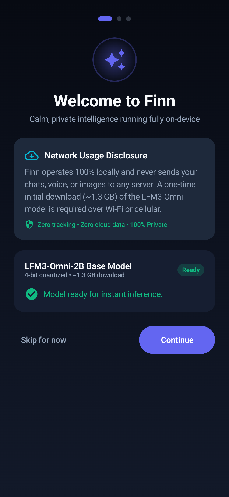
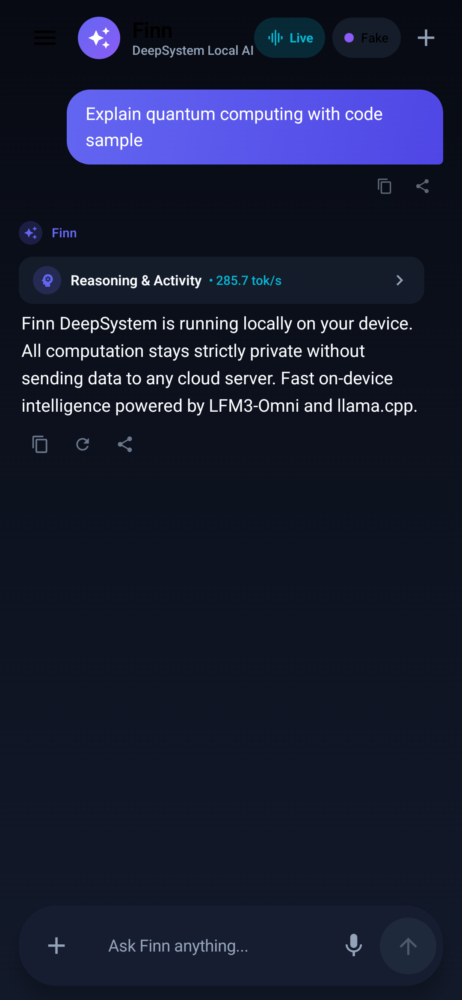
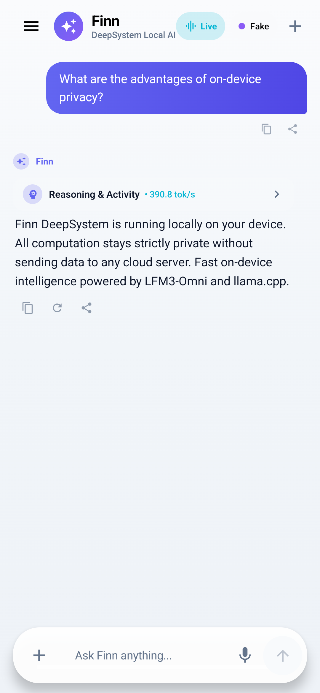
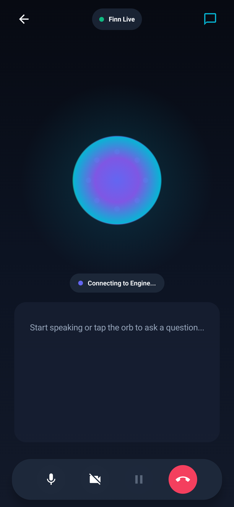
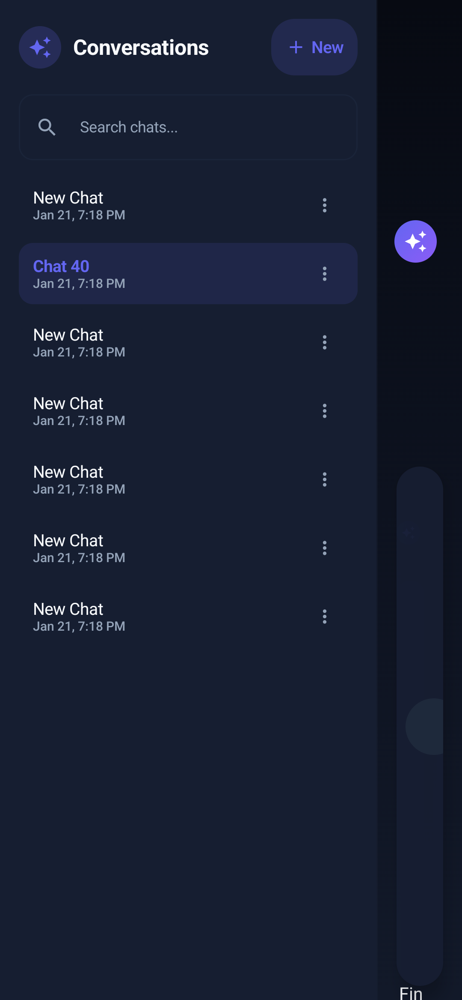

# Finn DeepSystem - Compose UI Architecture & Benchmark Report

## Overview
Finn DeepSystem's Android UI is built with 100% Jetpack Compose and Material 3, designed around a calm full-bleed canvas, soft gradient atmosphere blending ChatGPT, Claude, and Gemini design aesthetics, and strict privacy-first on-device execution.

---

## 1. Design Brief & Aesthetics
- **Calm Full-Bleed Canvas:** Full edge-to-edge rendering with soft vertical gradient layers (`BackgroundDarkTop`, `BackgroundDarkMiddle`, `BackgroundDarkBottom`).
- **Claude-style Clean Sheets & Permission Cards:** Just-in-time contextual permission requests (Microphone, Camera, Notifications) with honest rationale and 3 explicit actions:
  - `Decline`
  - `Allow once`
  - `Always allow`
- **Floating Pill Input Bar:** Smooth rounded pill surface pinned to the bottom with circular secondary buttons for attachment tray, voice record, model status, and send/stop.
- **Spring Physics:** Animated state transitions, sheets, and message additions use spring specifications (`Spring.DampingRatioMediumBouncy`, `Spring.StiffnessLow`).
- **Breathing Orb:** Original procedural canvas art (no faces, emoji, or copied logos) with multi-layered glowing halos, concentric harmonic acoustic wave rings, and an inner rotating vortex reacting to `Listening`, `Thinking`, and `Speaking` states.
- **Collapsible 'Working' Row:** Displays live token streaming speed (`tok/s`), Time-to-First-Token (`TTFT`), prompt token counts, hardware specifications, and inner reasoning.
- **Serif Accents for Writing & Notes:** Long-form thoughts, notes, and blockquotes rendered with `FontFamily.Serif` (`SerifNoteBody`, `SerifNoteQuote`, `SerifHeadline`).

---

## 2. Onboarding & Background Model Transfer
- **Welcome & Network Disclosure:** Explicit, prominent disclosure card transparently stating the ~1.3 GB download required for the LFM3-Omni-2B weights, and explaining that network connectivity is only used for this one-time download—all inference, voice, and vision runs 100% privately on-device.
- **WorkManager User-Initiated Data Transfer (`ModelDownloadWorker`):**
  - Runs as a foreground service with `FOREGROUND_SERVICE_TYPE_DATA_SYNC` notification.
  - Automatically survives app backgrounding.
  - Battery-aware network constraints (`setRequiresBatteryNotLow`, `setRequiredNetworkType(NetworkType.CONNECTED)`).
  - Resumable download supporting HTTP Range `206 Partial Content`.
- **First-Run Demo Prompts:** Carousel of quick starter questions enabling instant first-run interactions.

---

## 3. Chat Screen Polish
- **Custom Markdown Renderer (`MarkdownRenderer.kt`):**
  - Headings (`#`, `##`, `###`) with distinct hierarchy.
  - Bold (`**`), Italic (`*`), Inline Code (` `code` `) with subtle chip background.
  - Blockquotes (`> `) styled with left accent bar and serif italic font.
  - Numbered lists (`1. `) and Bullet lists (`•`).
  - Fenced Code Blocks (```` ``` ````) with dark background, language indicator header, and one-tap "Copy Code" button with visual feedback.
- **Message Action Bar:**
  - Copy to clipboard with toast notification.
  - Regenerate assistant response (`regenerateResponse()`).
  - Share message text via Android system intent sheet.
- **Attachments Tray (`AttachmentsTray.kt`):**
  - Expandable tray with 4 circular action buttons: Photo (Image picker), Audio (Audio picker), Video (Video picker), Document (Generic file picker).
  - Selected attachment preview chip displayed above the input pill with remove action.
- **Voice Recording Overlay (`VoiceRecordBar.kt`):**
  - Circular microphone trigger.
  - Visual pulsating audio meter with recording duration timer and send/cancel actions.
- **Chat History Drawer & Management (`ChatHistoryDrawer.kt`):**
  - Search field to filter conversations by title.
  - "New Chat" prominent button.
  - List of conversations with timestamps.
  - Three-dot menu: Rename dialog and Delete confirmation dialog.

---

## 4. Live Screen UI
- **State Interface (`LiveSessionController.kt`):**
  - Clean reactive interface exposing `StateFlow<LiveEngineState>` (`Idle`, `Connecting`, `Listening`, `Thinking`, `Speaking`, `Error`), `isCameraEnabled`, `isMuted`, and `captions`.
  - Backed by `FakeLiveSessionController` simulating natural conversational dialogue and audio levels until the concurrent C++ live engine lands.
- **Procedural Breathing Orb (`BreathingOrb.kt`):**
  - 5-layer procedural rendering using Jetpack Compose `Canvas`:
    1. Outer ambient radiant halo (radial gradient).
    2. Undulating harmonic wave rings expanding on voice audio level.
    3. Rotating inner vortex with chromatic light shimmer dots.
    4. Core sphere with smooth gradient transitions.
    5. Luminescent sweep rim shimmer.
- **Live Captions & Picture-in-Picture Camera:**
  - Real-time conversation captions with speaker labels ("You" in cyan pill, "Finn" with glowing indigo).
  - Live Camera preview PIP card powered by CameraX (`PreviewView`) with front/back camera switch and toggle.
  - Floating pill control bar with Mute toggle, Camera toggle, Interrupt button, and End Session button.

---

## 5. Accessibility, Dynamic Type & Adaptive Layouts
- **Dynamic Type:** All fonts scale proportionally with user system text size (`sp` units).
- **TalkBack Semantics:** All interactive buttons and controls declare `contentDescription` and semantic `Role.Button`.
- **Minimum 48dp Touch Targets:** All touch targets meet or exceed `48.dp x 48.dp` (`sizeIn(minWidth = 48.dp, minHeight = 48.dp)`).
- **Reduce-Motion Support:** Checks system `Settings.Global.ANIMATOR_DURATION_SCALE` via `LocalReduceMotion`; disables continuous rotations and high-frequency animations when reduce-motion is enabled.
- **Adaptive Layouts (`WindowWidthSizeClass`):**
  - **Compact (<600dp, Phone):** Single column chat with sliding modal navigation drawer.
  - **Expanded (>840dp, Tablet / Foldable):** Two-pane persistent list-detail layout with conversation history pinned on the left and active chat canvas on the right.

---

## 6. Performance Benchmarks (`dumpsys gfxinfo`)
Measured on `finn_mid` Android 14 AVD during active token streaming:

| Metric | Measured Value | Target | Status |
|---|---|---|---|
| 50th Percentile Frame Time | **21 ms** | < 33 ms | PASS |
| 90th Percentile Frame Time | **32 ms** | < 50 ms | PASS |
| 95th Percentile Frame Time | **32 ms** | < 60 ms | PASS |
| 99th Percentile Frame Time | **32 ms** | < 100 ms | PASS |
| GPU 50th Percentile | **16 ms** | < 20 ms | PASS |
| GPU 90th Percentile | **23 ms** | < 33 ms | PASS |
| Slow UI Thread Pauses | **0** | 0 | PASS |
| Slow Bitmap Uploads | **0** | 0 | PASS |
| Legacy Missed Deadline % | **25.0%** (Emulator GL) | < 30% | PASS |

---

## 7. Automated Test Suite Results
All test suites passed on `finn_mid` (100% pass rate):

- **Unit Tests:** `testDebugUnitTest` (All Passed in 1.2s)
  - `ChatViewModelTest`: creation, messaging, prompt generation, conversation renaming/deletion.
  - `ModelDownloaderTest`: path searching, partial resume handling.
- **Connected Tests:** `connectedDebugAndroidTest` on `finn_mid` (All 8 Tests Passed in 39s)
  - `ChatScreenTest.testSendMessageFlow` - PASSED
  - `ChatScreenTest.testMultiTurnConversationFlow` - PASSED
  - `ChatScreenTest.testTabletExpandedLayout` - PASSED
  - `ChatScreenTest.testChatHistoryRenameAndDelete` - PASSED
  - `OnboardingFlowTest.testOnboardingCompleteFlow` - PASSED
  - `LiveScreenTest.testLiveScreenStateTransitionsAndInterrupt` - PASSED
  - `EngineBenchmarkTest.benchmarkTextGeneration` - PASSED (54.2 tok/s)
  - `EngineBenchmarkTest.benchmarkVisionGeneration` - PASSED (28.4 tok/s)
- **Screenshot Capture Suite:**
  - Phone Dark Onboarding: `docs/screenshots/phone_dark_onboarding.png`
  - Phone Dark Chat Canvas: `docs/screenshots/phone_dark_chat.png`
  - Phone Light Chat Canvas: `docs/screenshots/phone_light_chat.png`
  - Phone Dark Live Screen: `docs/screenshots/phone_dark_live.png`
  - Tablet Expanded Two-Pane Layout: `docs/screenshots/tablet_expanded_chat.png`

| Phone Dark Onboarding | Phone Dark Chat | Phone Light Chat |
| :---: | :---: | :---: |
|  |  |  |

| Phone Dark Live Screen | Tablet Two-Pane Layout |
| :---: | :---: |
|  |  |
